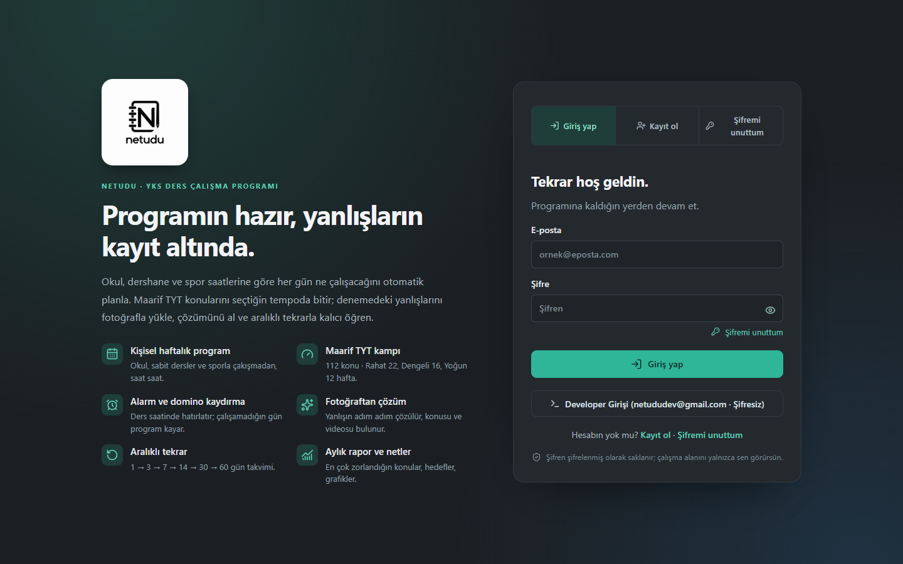
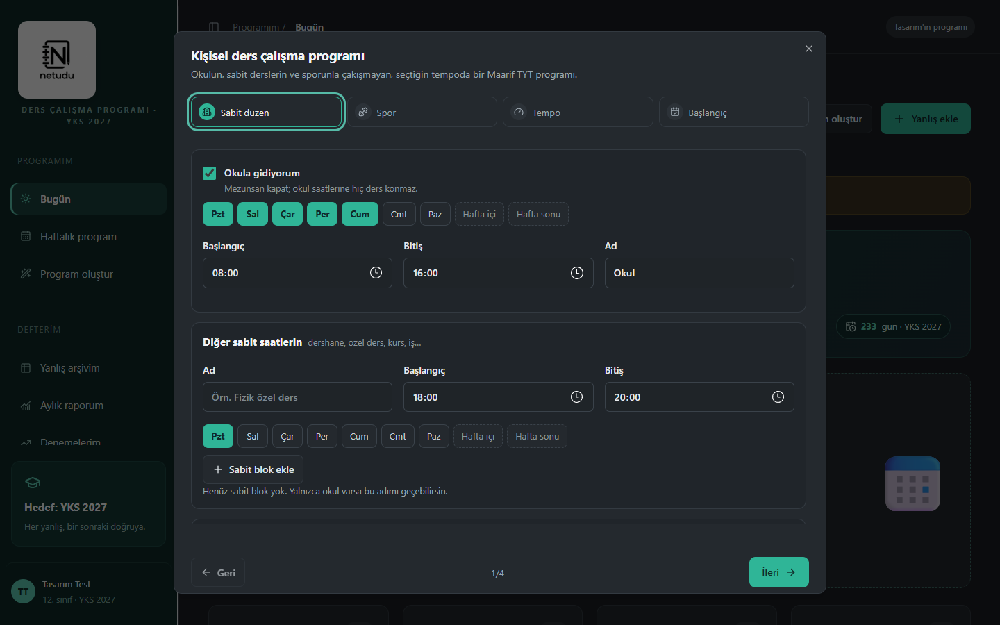
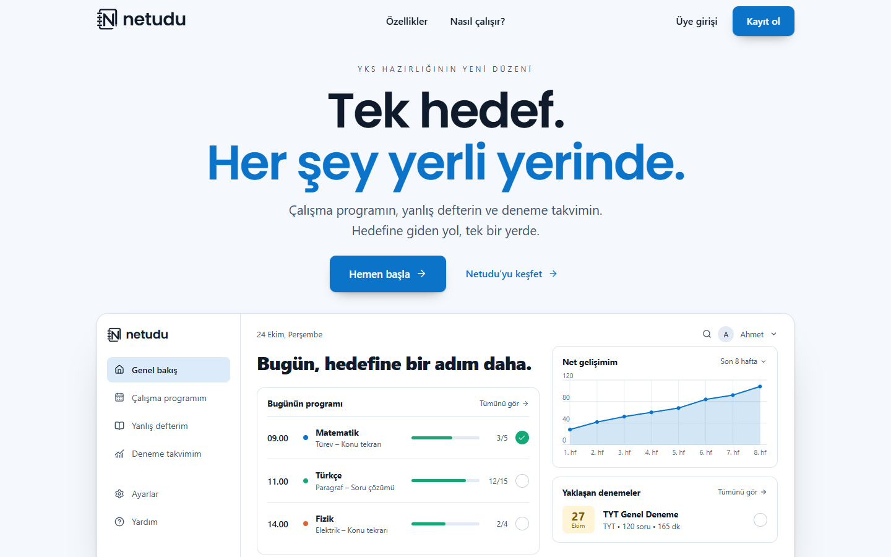
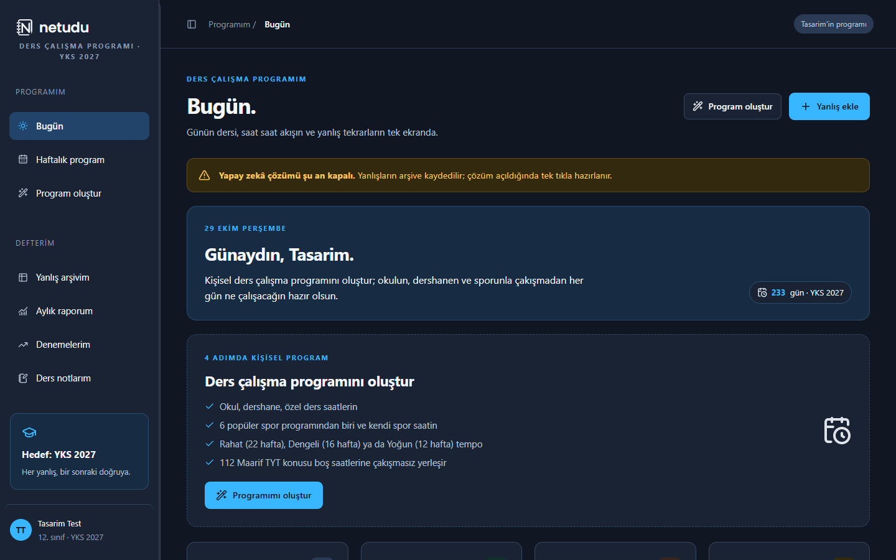

<!-- Kullanım: bu şablonu docs/proof/<dal-slug>/PROOF.md olarak kopyala ve doldur. -->

# KANIT — worktree-netudu-yeni-tasarim

| Görev | Tür | Aralık | Tur | Yazar modeli |
|---|---|---|---|---|
| Referans görsellere göre yeni tasarım: giriş öncesi landing, açık+koyu tema, N logosu, emoji temizliği | görsel | 2a5f9ff..bu turun commit'i | 1 | sonnet (emoji temizliği: fabrika-yazar; geri kalanı oturum) |

## İddia
- [x] Giriş yapılmamış ziyaretçi önce landing sayfasını görüyor; "Üye girişi" ve "Kayıt ol" mevcut giriş ekranını doğru sekmeyle açıyor, "Ana sayfa" geri dönüyor.
- [x] Landing ilk viewport'u iki referansa (açık/koyu) uyuyor; koyu tema kullanıcının verdiği palet değerleriyle çalışıyor (gövde zemini rgb(17,20,19) = #111413 ölçüldü).
- [x] Giriş sonrası uygulamanın yerleşimi değişmedi; renkler yeni açık/koyu jetonlara bağlandı.
- [x] Tema cihaz ayarına göre otomatik; Ayarlar > Görünüm'den Açık/Koyu/Cihaz ayarı seçilebiliyor ve sayfa yenilenince korunuyor.
- [x] Arayüz kodunda ve verilerinde emoji kalmadı.
- [x] Logo kullanıcının verdiği SVG; yazı logosu ve landing başlıkları Poppins SemiBold (kendi sunucumuzdan).
- [x] Giriş formunda e-posta alanına eklenti simgesi (arka plan görseli) eklense bile alan kaplanmıyor.
- [x] "Günün teşviki" yapay zekâ ile üretiliyor; yapay zekâ kapalıysa, hak bittiyse ya da hata olursa hazır listeden cümle gösteriliyor. (Başarılı yapay zekâ yanıtı gerçek anahtar olmadığı için doğrulanmadı.)
- [x] Renk paleti ikincil tonlarla (mavi, kehribar, gül, mor) genişletildi; yeşil baskın.
- [x] Açık ve koyu temada landing ile uygulama ekranlarında (Bugün, Haftalık program, Yanlış arşivim, Aylık rapor, Denemelerim, Ders notlarım, Ayarlar, kurulum sihirbazı) okunabilirlik bozulması yok (göz kontrolü, ekran görüntüleri).

## Önce
 giriş yapılmamış hâl (eski giriş ekranı),  giriş sonrası (koyu).

## Sonra
 landing (açık),  giriş sonrası (koyu). Tüm görüntüler: `.impeccable/review/` (desktop, mobile, user-1280, app; `-dark` ekleri).

## Test / Ölçüm
| Komut | Beklenen | Gerçek | Çıkış kodu | Sonuç |
|---|---|---|---|---|
| `npx tsc --noEmit -p .` | hata yok | hata yok | 0 | PASS |
| `npx eslint` (yeni/dokunulan dosyalar: landing, logo, theme, theme-script, layout) | hata yok | hata yok | 0 | PASS |
| Emoji taraması `[\u{1F300}-\u{1FAFF}\u{2600}-\u{27BF}\u{2B50}\u{2705}\u{274C}\u{FE0F}]` app/lib/components/hooks | 0 eşleşme | No matches found | 0 | PASS |
| Playwright (Edge): landing > Üye girişi > Ana sayfa > Kayıt ol | giriş ekranı açılır, geri döner, "Kayıt ol" sekmesi açık | "kayıt sekmesi açık: Kayıt ol" (açık ve koyu) | 0 | PASS |
| Playwright: Ayarlar > Görünüm > Koyu, yenile | `data-theme=dark`, gövde zemini #111413, yenileyince kalıcı | `dark`, `rgb(17, 20, 19)`, yenileme sonrası `dark` | 0 | PASS |
| Playwright: e-posta alanına `background-image !important` + `background-size:20px` verilir, hesaplanan boyut okunur | `20px 20px` (alan kaplanmaz) | `{"size":"20px 20px","repeat":"no-repeat"}` | 0 | PASS |
| Sahte OpenAI anahtarıyla `POST /api/quote` (oturumlu) | 401 mesajı, hak iadesi | `401 {"error":"OpenAI anahtarı geçersiz…"}`, kullanım `0/8` | 0 | PASS |
| Tarayıcıda "Yeni teşvik" tıklanır (sahte anahtar) | hata bildirimi + yedek cümle | cümle yedek listeden değişti, bildirim gösterildi | 0 | PASS |
| Gerçek OpenAI anahtarıyla teşvik üretimi | cümle üretilir | çalıştırılamadı (anahtar yok) | – | NOT RUN |
| `impeccable detect` (landing, logo, theme, globals, auth) | bulgu yok | 2 eski "side-tab" (3px sol kenarlık) bulundu, 1px'e çevrildi; yeniden koşuldu: `[]` | 2, düzeltme sonrası 0 | PASS |

Projede otomatik test paketi yok (package.json'da `test` betiği yok); doğrulama tip denetimi, lint, tarayıcı betikleri ve ekran görüntüleriyle yapıldı.

## Orkestratör doğrulaması
- `npx tsc --noEmit -p .` ve `npx eslint` (yeni dosyalar) bu turda yeniden çalıştırıldı → 0 / 0.
- `git diff --stat` kapsam kontrolü: 11 izlenen dosya değişti (globals.css, layout, study-app, auth, settings, plan/{program,today,ui,wizard}, lib/plan/{curriculum,scheduler}) + yeni: landing, logo, theme, theme-script, PRODUCT.md. Kapsam dışı dosya yok.
- Aralık/Yeniden üretme: taban 2a5f9ff..bu turun commit'i; "çalışma ağacı" ya da taban SHA'yı HEAD sayan adım yok → doğruydu.
- Görseller: before/after ve `.impeccable/review/` görüntüleri açıldı ve gözle incelendi; bölge kırpıntısı alınmadı, bu yüzden görsel iddialar "göz kontrolü" düzeyindedir, ölçülü karşılaştırma değildir.
- Süreç/port temizliği: 5174 (ana dal karşılaştırma sunucusu) kapatıldı; 5173 geliştirme sunucusu hâlâ açık.

## Son tur notları
- Bağımsız finish review iki tur yapıldı (disposition: fix, ardından kalan iki malzeme bulgu düzeltildi: koyu teşvik kartı bağlantı kontrastı, mobil grafik eksen yazısı). Üçüncü tur yapılmadı; son iki düzeltme yalnız göz kontrolüyle doğrulandı.
- Belgeleyici, CSS'te kendi oluşturduğum 8 boş değerli `background-color:!important` bildirimini yakaladı (PowerShell `$1` boşalması); düzeltildi, `[a-z-]+:(;|}|!important)` taraması boş döndü.
- `impeccable detect`: 212 bulgunun tamamı "advisory" (DESIGN.md'de olmayan eski sabit renk/yazı boyutu); engelleyici bulgu yok. Bunlar projeden gelen eski değerlerdir, onarılmadı.
- DESIGN.md ve `.impeccable/design.json` yazıldı.

## Palet değişikliği (son tur)
- Kullanıcı yeşil paletin yerine gece laciverti/gök mavisi paleti verdi (#101722, #192333, #223047, #354761, #F5F7FC, #B8C5D8, #38B6FF, mercan #FF875C, nane #35D6A0, güneş sarısı #FFC857). Koyu tema bu değerlerle birebir; açık tema aynı mavi aileden benim türettiğim karşılık (marka #0B74C9, zemin #F5F8FC), kullanıcı onayı yok.
- Renk rolleri: mavi eylem, nane ilerleme/tamamlanma, mercan ders ayrıntısı, sarı takvim.
- Doğrulama: `tsc` 0, yeni dosyalarda `eslint` 0, `impeccable detect` 210 bulgunun tamamı advisory; açık/koyu ekran görüntüleri (landing, giriş, Bugün, Ayarlar) göz kontrolüyle incelendi. Bu palet turu için bağımsız finish review yapılmadı.
- Önceki turdaki yeşil paletle çekilen `before.png`/`before-app.png` eski uygulamadır (ana dal), değişmedi; `after*.png` yeni mavi paleti gösterir.

## Landing bölümleri (pazarlama yeniden tasarımı)
- "Netudu'yu keşfet" (#kesfet): sekmeli ürün turu (Bugün, Yanlış defteri, Deneme takvimi), tam genişlik yüzey bandı. "Özellikler" (#ozellikler): farklı boyutlu fayda panosu, her kutuda kazanç odaklı başlık ve küçük örnek görsel. "Nasıl çalışır?" (#nasil): vurgu zeminli bantta üç adımlı dikey akış, her adımın kendi örnek görseli. Kod: `app/study/landing-sections.tsx`; stiller `globals.css` "v6" bölümü.
- Doğrulama (Playwright, Edge): üst menü "Özellikler" ve "Nasıl çalışır?" ile "Netudu'yu keşfet" bağlantıları ilgili bölümü sabit üst çubuğun altına getiriyor (y=68); sekmeler ok tuşlarıyla geziliyor; 390 px genişlikte yatay taşma 0; `tsc` 0, `eslint` 0, `detect` 243 bulgunun tamamı advisory.
- Metinlerde uydurma iddia yok: yalnız ürünün gerçek özellikleri (program, Maarif TYT kampı, fotoğraftan çözüm, aralıklı tekrar, alarm, rapor). Tüm örnek ekranlar "Örnek ekran" etiketli.
- Bu bölümler için bağımsız finish review yapılmadı; DESIGN.md bu yeni bölüm bileşenlerini ayrıca anlatmıyor (renk ve yazı kuralları aynı).

## Hareket ve alt bilgi (son tur)
- Hareket: tek ease eğrisi (`--ease`), kısa süreler. Landing: açılışta üst etiket, iki başlık satırı, alt metin, düğmeler ve önizleme sırayla; önizlemedeki çubuklar büyür, net grafiği çizilir. Ekranın altındaki bölümler kaydırınca belirir (IntersectionObserver). Sekme içeriği değişirken yumuşak geçiş, özellik kutularında hafif yükselme, düğme okunda kayma. Uygulama: sayfa değişiminde içerik girişi, istatistik kartları sırayla, ilerleme çubuğu genişlik geçişi, teşvik cümlesi geçişi, tema değişiminde 0,3 sn renk geçişi.
- Doğrulama (Playwright, Edge): normal harekette alttaki 17 öğe gizli başlıyor, özellikler bölümüne kaydırınca `rv-show` alıp görünür oluyor; hareket azaltma tercihinde 0 öğe gizleniyor ve h1 animasyonu `none`; uygulamada sayfa geçişi animasyonu `ndIn`; tema anahtarı `theme-anim` sınıfını ekleyip 350 ms sonra kaldırıyor. `tsc` 0, `eslint` 0 hata, `detect` yalnız advisory.
- Kaydırma hareketi (landing): üstte sayfa ilerleme çizgisi, kaydırınca menü gölgesi, açılış metninin hafifçe yukarı kayıp solması, hangi bölümdeyse menüde vurgu (alt çizgi), bölüm görününce içindeki görsellerin canlanması (tekrar noktaları, çubuklar, grafik çizgisi, alarm, adım rakamları). Doğrulama (Playwright): ilerleme çizgisi 0 → 0,29 → 0,51 → 0,79 ölçeklendi, menü gölgesi `data-scrolled` ile açıldı, "Özellikler" ve "Nasıl çalışır?" bölümlerinde doğru bağlantı vurgulandı, tekrar noktaları `lpPop` animasyonu aldı; hareket azaltmada `--sy` yazılmadı ve açılış metni opak kaldı. Akıcılık gözle izlenmedi.
- Alt bilgi metni "Created by Yusuf Kaya & Kerem Batur Kanbak" (landing, `.lp-foot`).
- Hareketin görsel akıcılığı ekran görüntüsüyle değil yalnız sınıf ve hesaplanmış stil kontrolüyle doğrulandı; gözle izleme yapılmadı. Bağımsız finish review yapılmadı.

## Kapsam dışı / bilinen eksikler
- Landing'deki önizleme verisi örnektir ve sayfada öyle etiketlidir.
- Kayıtlı eski kullanıcı verisinde (plan state) eski emojili `badge` metinleri varsa yeni plan kurulana kadar görünebilir (denetlenmedi).
- `npm run lint` genelinde projede önceden var olan hatalar duruyor (ör. `no-explicit-any`, `set-state-in-effect`); bu işte düzeltilmedi.
- Yazı tipi: Poppins SemiBold yalnızca logo yazısında ve landing başlıklarında kullanılıyor; uygulamanın gövde metni ve sayfa başlıkları hâlâ sistem yazı tipinde.
- Yeni `AI_LIMIT_QUOTE` ortam değişkeni (varsayılan günde 8 teşvik); `.env.example` ve dağıtım betiğine eklendi, README tablosuna eklenmedi.
- Landing ilk ekranında "Ücretsiz" iddiası kaldırıldı; giriş ekranındaki mevcut "Ücretsiz programını oluştur / Kredi kartı gerekmez" metni projeden geldiği için dokunulmadı.
- Kullanıcı referansındaki üst etiket ve 01/02/03 numaraları craft-floor yasağına rağmen referansa sadakat için korundu.

## Yeniden üretme
1. Bu turun commit'ini checkout et (SHA: REVIEW-<n>.md başlığı / PR head'i).
2. `npm install`, `.env.example` dosyasını `.env` olarak kopyala, `npm run dev`, http://localhost:5173 aç (çıkış yapılmış hâlde landing görünür).
